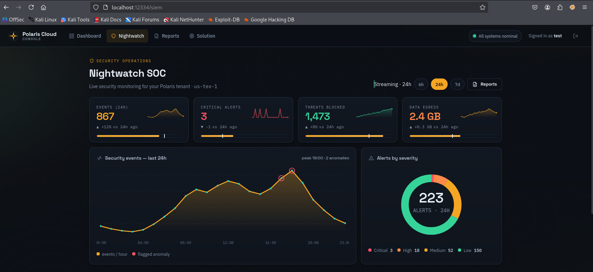

<p align="center"></p>

<h1 align="center">Nightwatch — Directory Traversal Lab</h1>

<p align="center"><strong>(Security+ SY0-701)</strong></p>

<h2 align="center">Start Here</h2>

<p align="center"><strong>Open a fresh terminal in Kali and paste the commands in the command block below</strong></p>

<p align="center">These commands pull the lab image, start the container, and open the <strong>Polaris Cloud</strong> console:</p>

```bash
docker run -d --name siem-traversal --pull=always -p 12334:8080 joshbeck2024/siem-traversal-flag-green-9:latest
nohup firefox http://localhost:12334 >/dev/null 2>&1 &
```

<p align="center"><a href="http://localhost:12334">http://localhost:12334</a></p>

<p align="center">The guided walkthrough and solution are built into the image.</p>

---

<h2 align="center">The Challenge</h2>

- Register an account on the **Polaris Cloud** console and sign in.
- Explore the cloud dashboard and the **Nightwatch** SOC (charts, alerts, threat map, data flows).
- **Flag location:** `/private_folder/flag.txt`

---

## What this teaches (SY0-701)

- **Directory / path traversal** = building a file path from **user input** that isn't validated.
- `../` climbs up the directory tree and escapes the folder the app meant to serve.
- It's a classic **input-validation** failure.
- Squarely on the **SY0-701** exam.

## Requirements

- Kali Linux or Ubuntu (any Linux with Docker running).
- Docker installed and running.
  - Not installed? `apt install docker.io`
  - Building from source instead also needs `docker-compose` and `git`.

## Folder layout

```
.
├── README.md
├── start_container.sh            <- builds + starts the console on :12334
├── teardown_container.sh         <- stops and removes the container
├── docker-compose.yml
├── Dockerfile
├── app/                          <- the Flask web app (the vulnerable console)
│   ├── app.py                    <- routes, fake data, the vulnerable /show-report
│   ├── templates/                <- landing, auth, dashboard, Nightwatch SOC, report viewer
│   ├── static/
│   │   ├── style.css             <- Nightwatch theme
│   │   ├── js/app.js             <- chart tooltips, sortable tables, filters
│   │   ├── fonts/                <- self-hosted web fonts (SIL OFL)
│   │   └── img/                  <- hero / texture / empty-state art
│   └── data/reports/             <- the legit report files served by name
└── (private_folder/flag.txt)     <- the traversal target; DROPPED AT BUILD TIME
                                      from a triple-encoded blob in the Dockerfile,
                                      so no plaintext flag sits in the source tree
```

> **Note:** the guided walkthrough and solution pages (`Tutorial/`) are **not committed to this
> repo** — they are copied into the container image at build time and served inside the running
> console at `/solution.html` and `/sub-page.html` (reachable from the **Solution** nav link once
> you're signed in).

## Safety and scope

Everything is **fictional** and runs locally in a container. The app is **intentionally
vulnerable** for teaching only &mdash; never copy the `/show-report` pattern into real code.
Use these techniques only on systems you own or are authorized to test.
